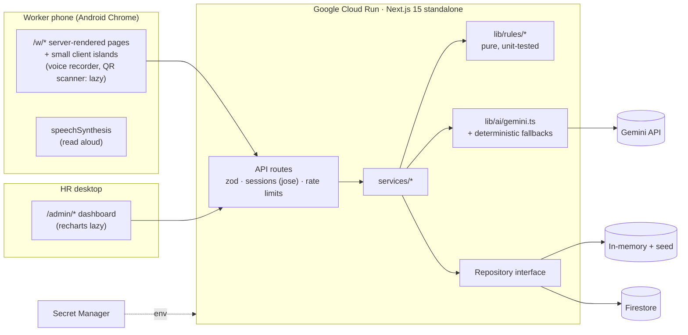

# PAYSA: Decent Work Platform

> Prompt Wars 2026 × SRM ACM · UN SDG 8 (Decent Work & Economic Growth)

## The problem

Construction crews and campus support staff are run on paper registers, spreadsheets and WhatsApp.
Unpaid overtime goes unnoticed, exhaustion is invisible until someone gets hurt, and workers stay silent about danger or abuse because speaking up is risky.
PAYSA turns one shift check-in into fair pay, safety alerts and an anonymous voice, in the worker's own language.

## SDG 8 targets addressed

| Target | How PAYSA helps |
|---|---|
| **8.5** Decent work and equal pay | Automatic overtime from real check-ins; plain-language payslip in Tamil, Hindi or English that is read aloud; one-tap "Something wrong?" pay grievance |
| **8.7** Forced-labour signals | Fatigue rules (12h+ shifts, < 8h rest, 60h+ weeks), late or missed pay, and anonymous "forced overtime / threats" feedback are all surfaced to HR with reasons |
| **8.8** Safe and secure working environments | Voice-first anonymous hazard reports with AI triage, a red banner for critical reports, a status timeline and two-way anonymous chat |

## Features

The deck asked for at least 3 working features. PAYSA ships 8.

| # | Feature | Where |
|---|---|---|
| 1 | **Shift check-in (QR or GPS) with automatic overtime.** The QR code rotates daily, GPS check-in is geofenced, and double check-ins are rejected. | `/w/home`, `/w/checkin`, `/admin/sites` |
| 2 | **Clear payslip in the worker's language.** Shows line items, OT hours stated explicitly, a 🔊 Listen button and a prefilled pay grievance. | `/w/pay` |
| 3 | **Voice-first safety and grievance reporting.** Pick an icon, hold to speak, add an optional photo (EXIF stripped). Reports are anonymous by default and come back with a tracking ID. | `/w/report`, `/w/report/[trackingId]` |
| 4 | **Honest anonymous feedback.** A weekly 5-face pulse, anonymous manager/conditions feedback and two-way anonymous chat. Aggregates are shown only when k ≥ 5. | `/w/voice`, `/admin` |
| 5 | **Fatigue alerts.** Workers get a gentle banner with the reason and the numbers. Admins get a 14-day heatmap and can log an action. | `/w/home`, `/admin/fatigue` |
| 6 | **Admin dashboard.** KPIs, attendance trend (chart + table), reports inbox with filters, status updates and a sector switcher. | `/admin/*` |
| 7 | **Skill Passport.** Skills plus verified days worked, employer endorsements, and a shareable QR or link that never shows phone number or wage. | `/w/passport`, `/p/[passportId]` |
| 8 | **Daily notices.** Short notices that workers can listen to. | `/admin/notices`, `/w/home` |

**Explainable quit-risk** (`/admin/attrition`) scores each worker from 0 to 100 against their own baseline. It always shows the top 2 reasons and a suggested action. Anonymous reports are never an input.

## Cross-sector: one engine, sector templates

Both sectors run on the same rules, screens and data model. Only `src/lib/sectors.ts` and the locale labels differ:

| | Construction Site | College Campus Staff |
|---|---|---|
| Demo org | Sri Vinayaka Builders (2 sites, 13 workers) | Greenfield College of Engineering (2 sites, 12 workers) |
| Hazard icons | fall from height, no safety gear, electrical, machinery, heat, collapse | wet floor, cleaning chemicals, electrical, heavy lifting, harassment |
| Shift pattern | day shifts | rotating morning / evening / night, including 12h night guards |
| Skills | masonry, bar bending, scaffolding, welding… | housekeeping, gardening, lab assistance, security… |

Use the **sector switcher** in the admin sidebar to see both.

**Adding hospitals or factories** needs one new config object and its labels:

```ts
hospital: {
  label: "Hospital Support Staff",
  hazardCategories: ["needle_stick", "infectious_waste", "patient_lifting", "violence", "chemical_cleaning", "other"],
  shiftPattern: "rotating", standardDailyHours: 8, otMultiplier: 2,
  skills: ["ward_assistance", "sterilisation", "housekeeping", "patient_transport", "security"],
},
```

Check-in, overtime, payslips, fatigue, quit-risk, anonymity and the passport work unchanged.

## Demo logins

All workers use PIN **1234**.

| Who | Login | What to look at |
|---|---|---|
| Construction worker (Tamil) | phone `9000000001` | Overworked: fatigue banner, heavy OT on last week's payslip, endorsed skills |
| Construction worker (Hindi) | phone `9000000002` | Hindi UI and payslip |
| College housekeeping (Tamil) | phone `9000000101` | Rotating shifts, short rest between shifts |
| Admin / HR (both orgs) | `admin@paysa.demo` / `demo1234` | Critical banner, heatmap, quit-risk, reports |

Demo tracking codes (no login needed): `PS-7K2Q9M` (critical fall hazard, Tamil) and `PS-H3KMT4` (PPE hazard with chat).

Seed data is generated relative to "now", so the dashboard always shows recent activity: 6 weeks of shifts, critical-fatigue and high-risk workers in both sectors, and a 4-person team whose mood is hidden by k-anonymity.

## Architecture



* **Business logic** (`src/lib/rules/`) is pure TypeScript with no I/O and is fully unit tested: overtime, payslip, fatigue, attrition, anonymity, geo and classify.
* **Worker pages** are server components. Client JS covers only interactive pieces, so `/w/home` ships about 109 KB First Load JS (budget 150 KB). The QR scanner, voice recorder and charts load lazily.
* **AI is optional.** Without `GEMINI_API_KEY` the app uses a Tamil/Hindi/English keyword classifier and template payslip text, and voice notes fall back to typing. Gemini output is schema-validated. It can never lower a severity that the keyword rules flagged, and an explanation that changes the net pay amount is discarded.

## How anonymity is guaranteed

1. **Nothing identifying is stored.** For an anonymous report `workerId` is never written, and `createdAt`, the first timeline entry and the worker's chat replies are rounded to the hour, so they can't be matched against check-in logs. See `reportIdentity()` in `src/lib/rules/anonymity.ts`, which is the only place identity is decided.
2. **The tracking code is the only way back.** `PS-XXXXXX` is drawn from a crypto-random, unambiguous alphabet. The public track endpoint returns status, timeline and messages only, and is tested to contain no identity fields.
3. **Photos are cleaned twice.** The phone re-encodes the photo through a canvas, and the server strips every JPEG APP1–APP15 and comment segment (EXIF, GPS, XMP).
4. **Small groups stay hidden (k-anonymity).** Team mood is shown, and used in quit-risk, only when 5 or more people responded. Otherwise the dashboard says "Not enough responses".
5. **Anonymous reports never feed an individual's quit-risk score.** This is enforced in `deriveAttritionSignals` and covered by a test.
6. **Manager feedback is always anonymous**, and IPs used for rate limiting are hashed in memory and never stored. Report text is never logged.

## Run locally

```bash
npm install
npm run dev          # http://localhost:3000, no cloud config needed
```

Optional `.env.local` (see `.env.example`):

| Var | Purpose |
|---|---|
| `GEMINI_API_KEY`, `GEMINI_MODEL` | Turns on voice transcription/translation, AI triage and AI payslip wording (server only) |
| `SESSION_SECRET` | 32+ chars; signs sessions and daily QR tokens. Without it a per-process random secret is used. |
| `FIRESTORE_PROJECT_ID` | Uses Firestore instead of memory and seeds it on first boot |

## Deploy to Cloud Run

```bash
# one-time secrets
printf '%s' "<gemini key>" | gcloud secrets create gemini-key --data-file=-
openssl rand -hex 32 | tr -d '\n' | gcloud secrets create session-secret --data-file=-

gcloud run deploy paysa \
  --source . --region asia-south1 --allow-unauthenticated \
  --set-secrets GEMINI_API_KEY=gemini-key:latest,SESSION_SECRET=session-secret:latest \
  --set-env-vars GEMINI_MODEL=<model>,NODE_ENV=production \
  --memory 512Mi --min-instances 1 --max-instances 3
```

The multi-stage `Dockerfile` (node:20-alpine) builds Next.js `output: "standalone"` and runs as a non-root user on port 8080.

Without Firestore, the in-memory store resets on cold start. Keep `--min-instances 1` for the demo, or add `--set-env-vars FIRESTORE_PROJECT_ID=<project>`. That requires giving the service account the `roles/datastore.user` role.

## Tests and quality

```bash
npm test          # Vitest: rules, AI fallbacks, anonymity API, passport privacy, seed scenarios, components
npm run lint
npm run typecheck
```

Accessibility: semantic landmarks, a skip link, visible `focus-visible` rings, `aria-live` results, and status always shown as icon + text. Every text/background colour pair is WCAG AA (≥ 4.5:1) in light and dark themes, `<html lang>` follows the chosen language, and `prefers-reduced-motion` is respected. The chart also has a table view.

Security: bcrypt-hashed PINs and passwords, HttpOnly + Secure + SameSite=Lax JWT session cookie, a zod-validated input on every route, per-org authorization checks, a same-origin check on mutating API calls, token-bucket rate limits, and CSP / nosniff / Referrer-Policy / Permissions-Policy headers.
