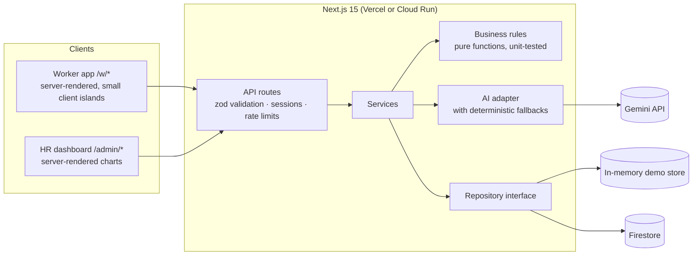

<div align="center">


# PAYSA

**Fair pay. Safe work. A voice for every worker.**

A worker-first workforce platform for construction sites and campus support staff,<br />
built for UN Sustainable Development Goal 8: Decent Work and Economic Growth.


<sub>Prompt Wars 2026 × SRM ACM</sub>

</div>

---

## Contents

- [Chosen vertical](#chosen-vertical)
- [Why PAYSA](#why-paysa)
- [How it works](#how-it-works)
- [Approach and decision logic](#approach-and-decision-logic)
- [Features](#features)
- [Tracking codes](#tracking-codes)
- [Two sectors, one engine](#two-sectors-one-engine)
- [Try the demo](#try-the-demo)
- [Getting started](#getting-started)
- [Deployment](#deployment)
- [Architecture](#architecture)
- [Privacy and anonymity](#privacy-and-anonymity)
- [Security](#security)
- [Accessibility and design](#accessibility-and-design)
- [Testing and quality](#testing-and-quality)
- [Project structure](#project-structure)
- [Assumptions](#assumptions)

---

## Chosen vertical

**UN SDG 8: Decent Work and Economic Growth.** The persona is a daily-wage or shift worker in a labour-intensive workplace, such as a construction labourer or a campus housekeeper, security guard or maintenance worker. These workers often have low literacy, a basic Android phone, and a first language other than English. The second persona is the supervisor or HR person responsible for them.

PAYSA is designed around one question for each persona:
- **Worker:** "Was I paid fairly, am I safe, and can I speak up without risk?"
- **Supervisor/HR:** "Who needs help *before* they get hurt or quit?"

## Why PAYSA

Labour-intensive workplaces still run on paper registers, spreadsheets and WhatsApp. The result is predictable:

- **Overtime goes unpaid** because nobody counts it.
- **Exhaustion is invisible** until someone is hurt.
- **Workers stay silent** about danger or abuse, because speaking up is risky.

PAYSA turns a single shift check-in into fair pay, early fatigue warnings and a safe, anonymous voice. Everything works in the worker's own language and on a low-cost Android phone.

| SDG 8 target | What PAYSA does |
|---|---|
| **8.5** Decent work and equal pay | Automatic overtime from real check-ins; a plain-language payslip that is read aloud; a one-tap pay grievance |
| **8.7** Signals of forced labour | Flags 12-hour shifts, short rest, 60-hour weeks, late pay and anonymous reports of forced overtime or threats |
| **8.8** Safe working environments | Voice-first anonymous hazard reports with triage, critical alerts for HR, a public status timeline and two-way anonymous chat |

## How it works

```
 Check in (QR or GPS)  ──►  hours & overtime  ──►  payslip in the worker's language
          │                        │
          │                        └──►  fatigue rules  ──►  rest alerts for worker & HR
          │
          └──►  attendance patterns  ──►  explainable quit-risk for HR

 Report a hazard (voice, any language, anonymous)  ──►  tracking code  ──►  status + private chat
```

One check-in feeds everything. Business rules are deterministic, unit-tested and explain themselves: every alert and score shows the reason, with numbers.

## Approach and decision logic

PAYSA behaves like an assistant that adapts to **who** the user is and **what is happening to them**. All decisions live in pure, unit-tested functions in `src/lib/rules/`, separate from the UI, so every outcome can be traced and explained.

| Context | Decision | Rule (source) |
|---|---|---|
| Hours worked | Overtime and pay | Hours beyond 8 a day are overtime (configurable, capped at 9). Regular hours beyond 48 in a Mon–Sun week also count, without double-counting. Shifts crossing midnight are split across days. Overtime is paid at 2×. (`overtime.ts`, `payslip.ts`) |
| Shift pattern | Fatigue level | **Warning:** shift over 10h, rest under 11h, more than 6 days in a row, or over 54h/week. **Critical:** shift over 12h, rest under 8h, or over 60h/week. Each reason is stated with numbers. (`fatigue.ts`) |
| Last 14 days vs the worker's own baseline | Quit-risk score 0–100 | Adds points for rising absences (+20), fatigue days (+5 each, max 20), weeks over 54h (+15), late pay (+20), low team mood (+10, only with 5+ responses), tenure under 90 days (+10) and a silent team (+5). Bands: under 30 low, 30–59 medium, 60+ high. Always returns the top reasons and a suggested action. (`attrition.ts`) |
| Report text in any language | Category and severity | A Tamil/Hindi/English keyword classifier, optionally refined by Gemini. AI may raise but never lower a severity the safety rules flagged. (`classify.ts`, `ai/gemini.ts`) |
| Anonymous or named | What is stored | Anonymous reports store no worker ID and only hour-level time; a random tracking code is the only link back. (`anonymity.ts`) |
| Group size | What HR may see | Team aggregates are hidden below 5 responses (k-anonymity). (`anonymity.ts`) |
| GPS location / QR token | Whether check-in is allowed | Must be inside the site's radius, or present today's HMAC-signed site code. Double check-ins are rejected. (`geo.ts`, `qr.ts`) |
| Language, sector, role | What the user sees | UI language, voice and spoken time formats follow the worker's choice. Hazard categories and skills follow the sector. Workers see only their own data, HR only their organisations. |

## Features

### For workers (mobile, Tamil / Hindi / English)

| Feature | Highlights |
|---|---|
| **Shift check-in** | Scan the site's daily QR code or use GPS inside the site boundary. Rejects expired codes, out-of-range locations and double check-ins. |
| **Payslip I can understand** | Normal pay, overtime (counted at 2×) and deductions as clear cards, with a plain-language explanation and a **Listen** button. "Something wrong?" opens a pre-filled pay complaint. |
| **Voice-first reporting** | Pick an icon, hold the button and speak in any of the three languages, optionally add a photo. Reports are **anonymous by default**. |
| **Report tracking** | A step-by-step timeline (Received → Being checked → Action taken → Solved) and a private chat with HR, reached with a tracking code. |
| **Rest alerts** | A gentle warning with the exact reason, e.g. *"You worked 63 hours this week (limit 60)"*. |
| **My voice** | A one-tap weekly mood check and anonymous feedback about managers or conditions. |
| **Skill Passport** | Verified days worked, skills and employer endorsements as a shareable ID badge and QR code. Phone number and wage are never shown. |
| **Notices** | Daily announcements in the worker's language, readable aloud. |

### For supervisors and HR (desktop)

| Feature | Highlights |
|---|---|
| **Overview** | Live headcount, open reports by severity, average resolution time, critical alerts, attendance trend and weekly regular-vs-overtime hours. |
| **Reports inbox** | Filter by type, severity, status and site. Update status and severity, and reply anonymously. Every update appears on the worker's tracking page. |
| **Fatigue grid** | Workers × last 14 days, with reasons for each flagged day and a log of actions taken (rest given, shift swapped…). |
| **Quit risk** | An explainable 0–100 score per worker, a risk gauge, a risk map and a suggested action for each worker. |
| **Sites & QR** | Printable daily QR posters for every site. |
| **Sector switch** | Move between the construction and campus organisations in one click. |

## Tracking codes

A **tracking code** (for example `PS-7K2Q9M`) is the receipt a worker gets after sending a report.

- **It is the only link between the worker and the report.** For anonymous reports PAYSA stores no name, phone number or exact time, so the code is the worker's way to come back.
- **Anyone holding the code can check progress**, at `/w/report/PS-XXXXXX` or via "Enter your tracking code" on the home page. No login is needed, so a worker can check from any phone. They see the status timeline and HR's messages, and can reply without revealing who they are.
- **It is easy to read out and write down.** The 6 characters avoid look-alikes (no `0/O`, `1/I/L`) and are generated with a cryptographically secure random source.
- **It is shown once**, with Copy and Listen buttons. Workers are told to keep it safe.

Try `PS-7K2Q9M` (a critical fall hazard reported in Tamil) or `PS-H3KMT4` (a safety-gear report with an ongoing chat).

## Two sectors, one engine

Every rule, screen and data structure is shared; each sector is a small configuration in `src/lib/sectors.ts` plus its translated labels.

| | Construction site | College campus staff |
|---|---|---|
| Demo organisation | Sri Vinayaka Builders: 2 sites, 13 workers | Greenfield College of Engineering: 2 sites, 12 workers |
| Hazard categories | Fall from height, missing safety gear, electrical, machinery, heat, collapse | Wet floor, cleaning chemicals, electrical, heavy lifting, harassment |
| Shift pattern | Day shifts | Rotating morning / evening / night, including 12-hour security shifts |
| Skills | Masonry, bar bending, scaffolding, welding… | Housekeeping, gardening, lab assistance, security… |

Adding a new sector, such as a hospital or a factory, takes one configuration object:

```ts
hospital: {
  label: "Hospital Support Staff",
  hazardCategories: ["needle_stick", "infectious_waste", "patient_lifting", "violence", "chemical_cleaning", "other"],
  shiftPattern: "rotating", standardDailyHours: 8, otMultiplier: 2,
  skills: ["ward_assistance", "sterilisation", "housekeeping", "patient_transport", "security"],
},
```

## Try the demo

All worker accounts use PIN **1234**.

| Role | Sign in with | Worth a look |
|---|---|---|
| Construction worker (Tamil) | `9000000001` | Rest alert, heavy overtime on last week's payslip, endorsed skills |
| Construction worker (Hindi) | `9000000002` | The whole app in Hindi |
| Campus housekeeping (Tamil) | `9000000101` | Rotating shifts and short rest between shifts |
| Supervisor / HR, both organisations | `admin@paysa.demo` / `demo1234` | Critical alert, charts, fatigue grid, quit risk |

The demo data is generated relative to today, so the dashboards always show recent activity: six weeks of shifts, overworked and at-risk workers in both sectors, and a four-person team whose mood stays hidden to protect anonymity.

## Getting started

**Requirements:** Node.js 20 or later.

```bash
git clone https://github.com/shreyascode11/PAYSA.git
cd PAYSA
npm install
npm run dev          # http://localhost:3000
```

No accounts or keys are needed to run locally. PAYSA falls back to an in-memory store with demo data and to deterministic (non-AI) features.

### Configuration

Copy `.env.example` to `.env.local` and set what you need. Secrets are read only on the server and never sent to the browser.

| Variable | Purpose |
|---|---|
| `SESSION_SECRET` | 32+ random characters (`openssl rand -hex 32`). Signs sessions and daily QR codes. **Required in production.** |
| `FIRESTORE_PROJECT_ID` | Store data in Firestore instead of memory; seeded automatically on first start. |
| `FIREBASE_SERVICE_ACCOUNT` | Service-account JSON (one line) for Firestore on hosts without Google credentials, such as Vercel. |
| `GEMINI_API_KEY`, `GEMINI_MODEL` | Optional AI: voice transcription and translation, report triage, payslip wording, notice translation. |

Without Gemini, PAYSA still works fully:

- **Voice input** uses the browser's built-in speech recognition in the worker's language.
- **Reports** are triaged by a Tamil / Hindi / English keyword classifier.
- **Payslips** are explained with translated templates.

## Deployment

### Vercel (recommended)

1. Import the repository at [vercel.com/new](https://vercel.com/new). Next.js is detected automatically, and `vercel.json` places the app in the Mumbai region (`bom1`).
2. Under **Settings → Environment Variables**, add `SESSION_SECRET`, and preferably `FIRESTORE_PROJECT_ID` with `FIREBASE_SERVICE_ACCOUNT`. Without Firestore, each serverless instance keeps its own demo data, so changes may not persist.
3. Deploy. Every push to `main` redeploys automatically.

Using the CLI instead: `npx vercel login`, then `npx vercel --prod`.

### Google Cloud Run (alternative)

```bash
printf '%s' "<gemini key>" | gcloud secrets create gemini-key --data-file=-
openssl rand -hex 32 | tr -d '\n' | gcloud secrets create session-secret --data-file=-

gcloud run deploy paysa \
  --source . --region asia-south1 --allow-unauthenticated \
  --set-secrets GEMINI_API_KEY=gemini-key:latest,SESSION_SECRET=session-secret:latest \
  --set-env-vars GEMINI_MODEL=<model>,NODE_ENV=production \
  --memory 512Mi --min-instances 1 --max-instances 3
```

The multi-stage `Dockerfile` builds a standalone Next.js server that runs as a non-root user on port 8080. For durable data, add `FIRESTORE_PROJECT_ID` and grant the service account `roles/datastore.user`.

## Architecture



- **Business rules** (`src/lib/rules/`) are pure TypeScript with no I/O: overtime, payslip, fatigue, attrition, anonymity, geofencing and report classification.
- **Lightweight pages.** Worker pages are server components; only interactive pieces ship JavaScript. The home screen loads about 109 KB of JavaScript, and the QR scanner and voice recorder load on demand. Charts are server-rendered, with no chart library sent to the browser.
- **Efficient analytics.**
  - Each worker's fatigue context is precomputed once and reused for every day.
  - Dashboard aggregates index shifts, actions, teams and pulses in single passes.
  - React `cache()` shares one data load per request across layout and page.
  - Firestore reads use indexed, chunked `in` queries instead of full scans.
  - The in-memory store freezes records on write and returns them without copying.
- **Guarded AI.** Gemini output is schema-validated. It can never lower a severity flagged by the safety rules, and an explanation that changes the net pay is discarded.

## Privacy and anonymity

1. **No identity on anonymous reports.** The worker's ID is never written, and times are rounded to the hour so they can't be matched to shift logs. One function, `reportIdentity()`, decides this.
2. **Tracking code only.** The public tracking endpoint returns status, timeline and messages, and is tested to contain no identifying fields.
3. **Photos are cleaned twice.** The phone re-encodes images, and the server strips all EXIF, GPS and XMP metadata.
4. **Small groups stay hidden.** Team mood is shown, and used in quit-risk, only when at least 5 people respond.
5. **Anonymous reports never affect an individual's quit-risk score**, enforced in code and covered by tests.
6. **Feedback about managers is always anonymous.** IP addresses used for rate limiting are hashed in memory and never stored, and report text is never logged.

## Security

- **Credentials:** PINs and passwords are hashed with bcrypt, with timing-safe checks for unknown accounts.
- **Sessions:** signed JWTs in an `HttpOnly`, `Secure`, `SameSite=Lax` cookie.
- **Inputs and access:** every API input is validated with zod into exact types (no unchecked casts). Authorization is checked per organisation on every route through one shared helper: 401 without a session, 404 for unknown records, 403 for other organisations.
- **Requests:** mutating API calls must be same-origin, and logins, reports and voice uploads are rate-limited.
- **QR codes:** check-in codes are HMAC-signed and rotate daily.
- **Headers:** a per-request **nonce-based Content-Security-Policy** with `strict-dynamic` (no inline scripts allowed), HSTS, `Cross-Origin-Opener-Policy`, `Cross-Origin-Resource-Policy`, `X-Content-Type-Options`, `Referrer-Policy`, `Permissions-Policy` and `X-Frame-Options`.
- **Secrets:** no secrets in the repository; `.env.example` lists names only.

## Accessibility and design

- **Audited with axe-core:** zero violations on all 25 page views (WCAG 2.2 AA + best practices), in English and Tamil.
- WCAG AA contrast for every text pair, computed for both the dark worker theme and the light admin theme.
- Full keyboard support, visible focus rings, a skip link, semantic landmarks and ARIA labels.
- Status is never shown by colour alone: every status carries an icon and a label.
- Every screen in the worker app has a **Listen** button. `<html lang>` follows the chosen language, and times use spoken forms such as காலை 7:09 or सुबह 7:09.
- Charts are server-rendered, keyboard-focusable and come with a table view.
- Motion respects `prefers-reduced-motion`.
- Visual language: the Holst palette (navy, slate, sage, sand, ivory), lanyard ID-badge sign-in and subtle glass surfaces.

## Testing and quality

```bash
npm test               # 148 unit, integration and component tests (Vitest + Testing Library)
npm run test:coverage  # with enforced coverage thresholds
npm run lint           # ESLint (Next.js rules)
npm run typecheck      # TypeScript strict mode
npm run check          # all of the above
```

Coverage of business logic, services, storage, security helpers and UI components is about **94% of lines**. The build fails if it drops below the thresholds in `vitest.config.ts`. GitHub Actions runs lint, type checks, tests with coverage and a production build on every push.

| Suite | What it proves |
|---|---|
| Business rules | Overtime (daily/weekly, midnight-crossing, open shifts), payslip and ESI, fatigue thresholds, quit-risk drivers and bands, geofencing, classification, EXIF stripping |
| API routes (end to end) | Login, geofenced and QR check-in, double check-in, one pulse per week, anonymous report storage, admin access limited to their own organisations |
| Security | Session signing and tamper rejection, daily QR token rotation, rate limiting, input validation, the nonce CSP and same-origin checks |
| Storage | Firestore repository (against an in-memory fake: one-time seeding, chunked queries, transactional checkout) and the frozen in-memory store |
| Services | Worker summary, payslip periods, attendance streak, dashboard aggregates (checked against a naive reference) |
| AI | Fallbacks without a key, and guardrails: invalid categories, lowered severities and changed pay amounts are all rejected |
| Privacy | Anonymous reports and the public tracking endpoint never contain identity; the Skill Passport never shows phone or wage |
| UI | Accessible names, status shown as text, the language switcher, nav state, timeline, dot calendar, gauge and chart |
| Content | Every UI string exists in English, Tamil and Hindi |

## Project structure

```
src/
├─ app/
│  ├─ w/            Worker app (home, check-in, pay, report, tracking, voice, passport)
│  ├─ admin/        HR dashboard (overview, reports, fatigue, quit risk, workers, sites, notices)
│  ├─ p/            Public Skill Passport
│  └─ api/          API routes
├─ components/      UI, including the design-system components in components/ui
├─ lib/
│  ├─ rules/        Pure business logic (unit-tested)
│  ├─ services/     Use cases combining rules and storage
│  ├─ repo/         Repository interface, in-memory and Firestore implementations
│  └─ ai/           Gemini adapter with fallbacks
├─ locales/         English, Tamil and Hindi strings
└─ data/seed.ts     Demo data for both sectors
tests/              Vitest suites mirroring src/
```

## Assumptions

- **Region and time:** India, with all day boundaries in IST (UTC+05:30, no daylight saving).
- **Work week:** Mon–Sun weeks with six scheduled working days; Sunday is the usual day off. Pay periods are weekly.
- **Labour rules:** overtime starts after 8 hours a day or 48 a week (in line with common Indian practice) and is paid at 2×. ESI is deducted at 0.75% of gross. These are configuration values, not legal advice.
- **Devices:** workers use a basic Android phone with Chrome. Read-aloud and browser speech recognition depend on the phone having Tamil/Hindi voices installed.
- **Sign-in:** phone number + 4-digit PIN for workers, and email + password for supervisors. This is demo-grade; production would add OTP verification.
- **Data:** the demo runs on generated data relative to today. Without Firestore configured, data is kept in memory and resets when the server restarts.
- **AI is optional:** without a Gemini key, every feature still works using deterministic fallbacks.
- **Admin language:** the supervisor/HR dashboard is English-only; the worker app is fully English, Tamil and Hindi.
- **Sites:** each site is a circle (centre + radius) for GPS check-in. One QR code per site, rotating daily.
